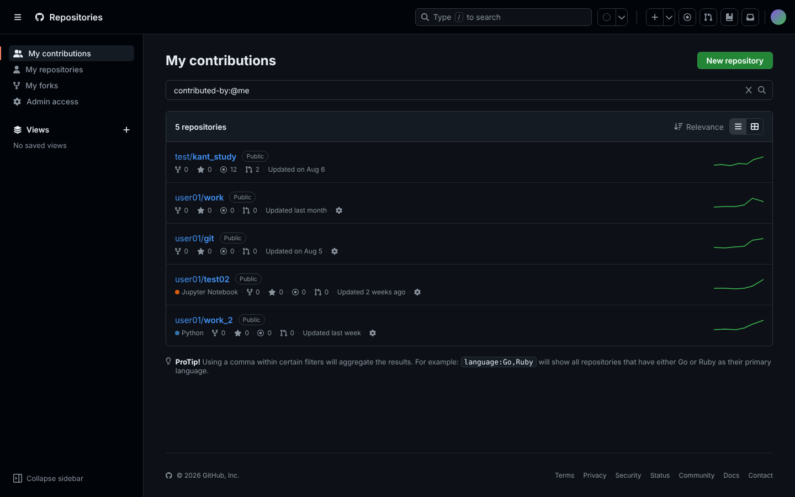
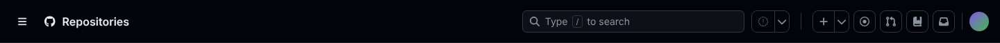
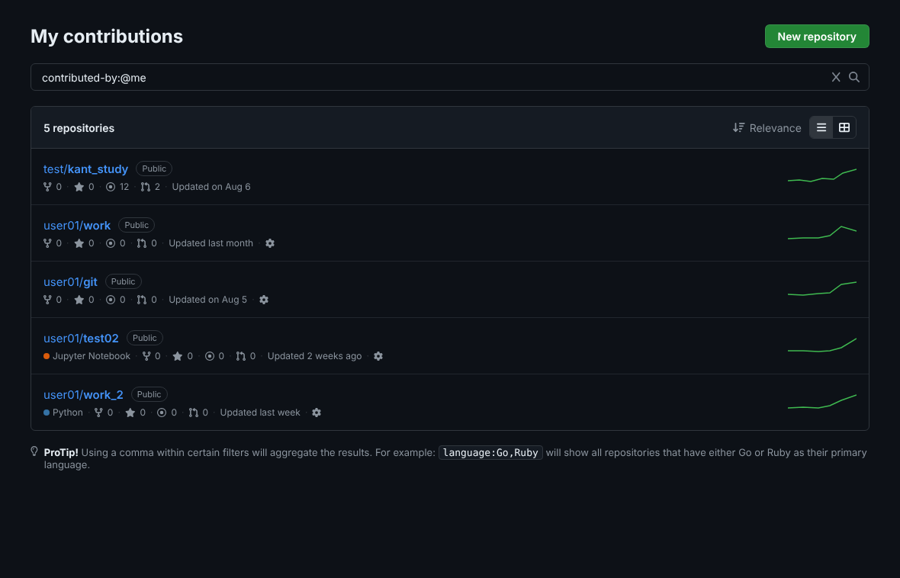
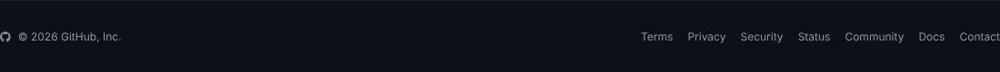
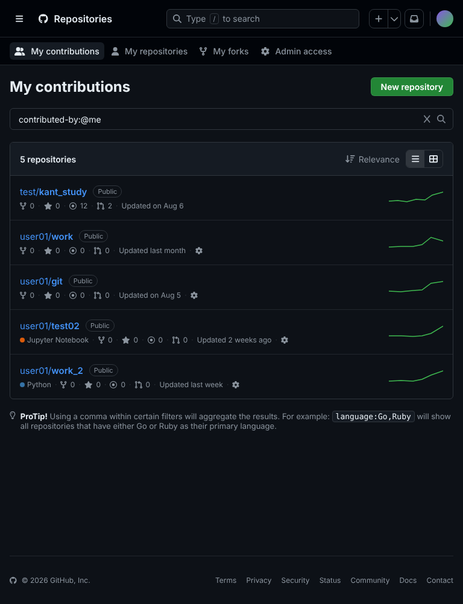
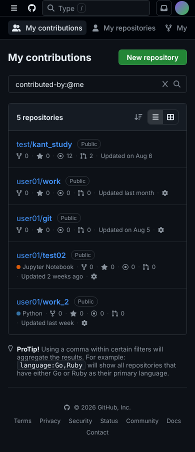
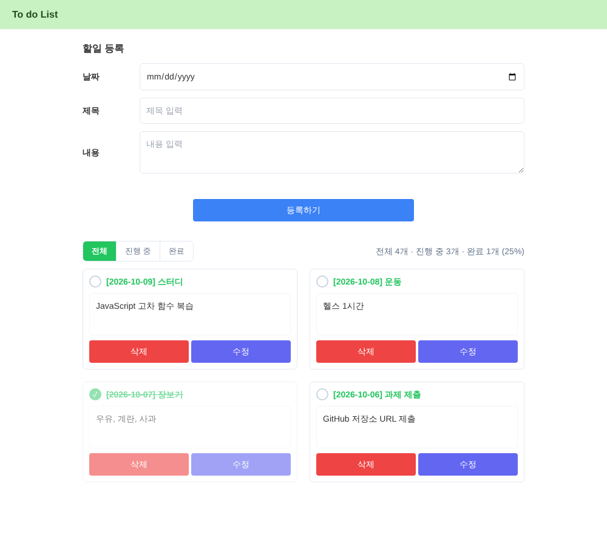

# 프론트엔드 평가 과제

| 과제 | 폴더 | 실행 |
| --- | --- | --- |
| 1. 클론 코딩 (HTML + CSS) | [`clone_coding/`](clone_coding) | `clone_coding/index.html`을 브라우저로 열기 |
| 2. Todo 리스트 (JavaScript) | [`todo/`](todo) | `todo/index.html`을 브라우저로 열기 |

---

## 1. 클론 코딩 — GitHub Repositories 페이지

### 구현 내용

**시맨틱 마크업 · 웹 접근성**
- `header` / `nav` / `aside` / `main` / `section` / `footer`로 영역을 나누고, 제목을 `h1 → h2 → h3` 순서로 구성
- 메뉴와 저장소 목록은 `ul > li > a`, 검색창과 필터는 `form role="search"` + `label`로 작성
- 아이콘만 있는 버튼에는 `aria-label`, 장식용 아이콘에는 `aria-hidden`, 
  그래프 SVG에는 대체 텍스트(`role="img"` + `aria-label`) 적용
- 현재 메뉴 `aria-current="page"`, 본문 바로가기 링크, 키보드 포커스 표시(`:focus-visible`)

**레이아웃 · 반응형**
- 전체 레이아웃(사이드바 | 콘텐츠)과 저장소 한 줄(정보 | 그래프)은 **Grid**, 헤더·메뉴·메타 정보는 **Flexbox**
- 브레이크포인트 3단계

| 화면 폭 | 변화 |
| --- | --- |
| 1012px 이하 | 사이드바 축소, 보조 아이콘 숨김 |
| 768px 이하 | 사이드바 → 상단 가로 메뉴, 1열 레이아웃 |
| 544px 이하 | 그래프·로고 텍스트 숨김, 푸터 세로 정렬 |

**재사용 가능한 스타일 구조**
- 색상·간격·크기·글꼴을 `:root` CSS 변수(디자인 토큰)로 관리하고, 브레이크포인트에서는 변수 값만 바꿔 전체를 조정
- `.hide-md` / `.hide-sm` 반응형 유틸리티, `.sr-only` 접근성 유틸리티, `.icon-btn` / `.btn-primary` / `.badge` 공통 컴포넌트

### 전체 화면

### 부분 화면

**헤더**

**메인**

**푸터**

### 반응형

| 태블릿 (768px) | 모바일 (390px) |
| --- | --- |
|  |  |

---

## 2. Todo 리스트

`index.html`, `css/style.css`, `js/todo.js` 구조로 작성했습니다.

### 구현 내용

**기능**

| 기능 | 설명 |
| --- | --- |
| 추가 | 날짜·제목·내용 입력 후 등록 (빈칸·공백만 입력 시 안내 메시지) |
| 조회 | 전체 / 진행 중 / 완료 필터, 진행 현황(개수·완료율) 표시 |
| 수정 | 수정 버튼 → 폼에 내용 채움 → 수정 완료 (취소 버튼, Esc로 취소) |
| 삭제 | 카드 삭제 (수정 중인 카드를 지우면 수정 모드도 종료) |
| 완료 | 체크 버튼으로 완료/미완료 전환 |

**데이터 처리 (배열 · 객체 · 고차 함수)**
- 할일을 `{ id, date, subject, content, done, createdAt }` 객체 배열(`state.todos`)로 관리
- 원본을 바꾸지 않고 새 배열을 반환하는 순수 함수로 CRUD 처리
  - 추가: 전개 연산자, 수정·완료: `map`, 삭제·조회: `filter`, 단건 조회: `find`, 통계: `reduce`
  - 화면 렌더링: `todos.filter(...).map(createCard)`
- 모든 변경은 `setState()` → `render()`를 거쳐 데이터와 화면이 항상 일치

**이벤트 처리 최적화**
- **이벤트 위임**: 카드마다 리스너를 달지 않고 목록(`ul`)과 필터 그룹에 리스너 1개씩만 등록, `data-action` 값으로 동작 구분
- `replaceChildren()`로 목록을 한 번에 교체해 DOM 갱신 최소화
- `textContent`로만 출력해 HTML 삽입(XSS) 방지

### 시연 영상

<!-- GitHub 웹에서 README 편집 시 docs/todo_demo.mp4 를 이 줄에 드래그하면 영상이 바로 재생되도록 바뀝니다 -->
📹 [시연 영상 보기 (docs/todo_demo.mp4)](docs/todo_demo.mp4)

추가 → 빈칸 검증 → 완료 체크 → 조회 필터 → 수정 → 삭제 순서로 동작합니다.

### 화면

